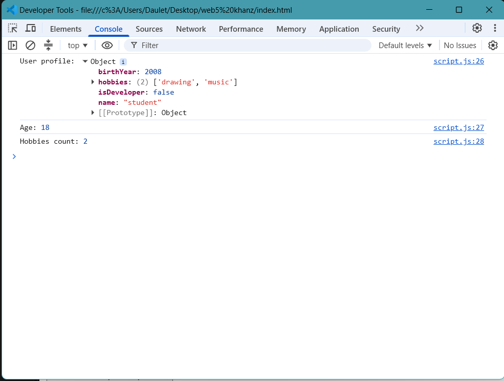
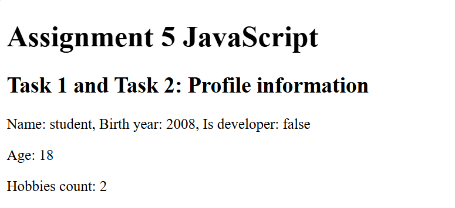
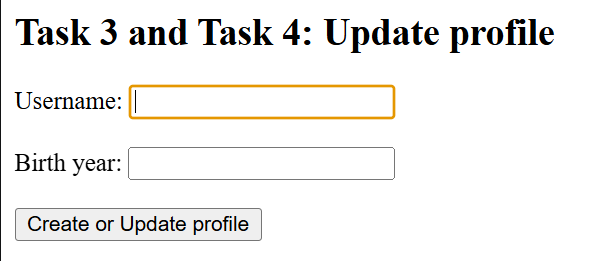
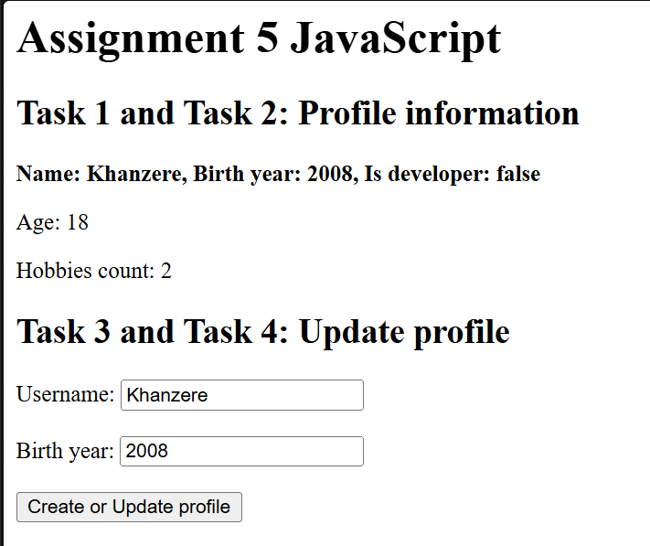
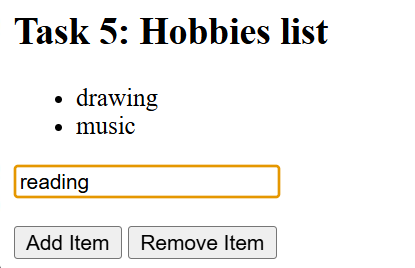
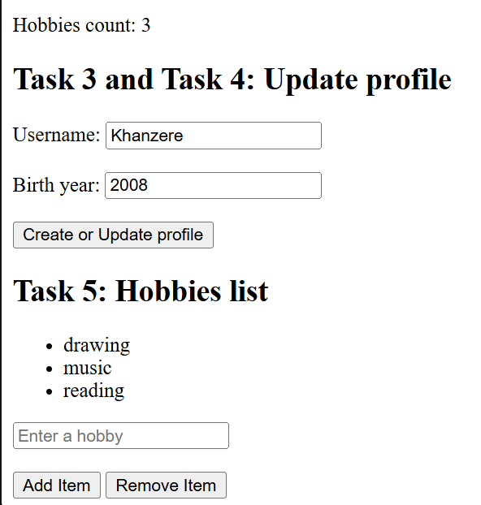

# Assignment 5: JavaScript
**Student:** Suleimen Khanzere
**Group:** IT-2504
https://khanziik.github.io/web5/

## Part 1: Profile object, data types & arithmetic
### Task 1: Personal info object
Created a JavaScript object named `userProfile` containing a name, birth year, developer status, and hobbies array.

### Task 2: Arithmetic calculations
Used JavaScript to calculate age dynamically using the current year and birth year. Also calculated the total number of hobbies.
Displayed the results on the webpage and in the browser console.

## Part 2: Form input & event responses
### Task 3: HTML form setup
Created a form with Username and Birth Year inputs and a Create / Update Profile submit button.

### Task 4: Event listener
Added a submit event listener that reads the input values and updates the `userProfile` object.
The updated information is displayed on the page.

## Part 3: DOM list manipulation
### Task 5: Creating & removing elements
Created an unordered list of hobbies.
The Add Item button creates a new list item.
The Remove Item button removes the last item.

## Summary
In this assignment, I learned how to create JavaScript objects, work with different data types, perform arithmetic calculations, and display results. I also practiced using event listeners and manipulating HTML elements with JavaScript.
